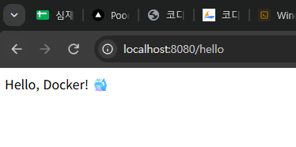
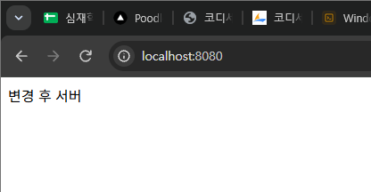
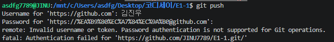
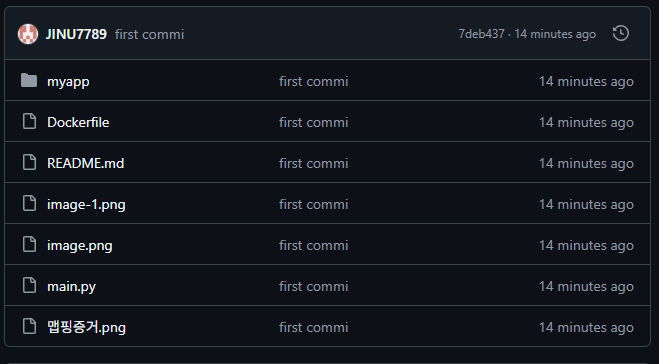

# 개발 워크스테이션 구축

## 1. 프로젝트 개요

개발은 코드를 작성하는 순간이 아니라, 환경을 세팅하는 순간부터 시작됩니다.  
이 프로젝트는 리눅스 CLI(터미널), Docker(컨테이너), Git/GitHub(버전 관리 및 협업)를 직접 세팅하고 운영하는 경험을 목표로 합니다.

**핵심 목표**
- 터미널로 작업 디렉토리와 권한을 정리한다.
- Docker를 설치·점검하고 컨테이너를 실행·관리한다.
- 간단한 웹 서버를 Dockerfile로 컨테이너화하고, 포트 매핑으로 접속을 확인한다.
- 바인드 마운트/볼륨으로 변경 반영과 데이터 영속성을 검증한다.
- Git/GitHub로 소스코드를 버전 관리하고 협업 환경을 구성한다.

---

## 2. 개발 환경

- OS : 	Ubuntu 26.04.1 LTS
- 쉘/터미널 : bash
- Docker 버전 : Docker version 29.9.2
- Git 버전 : git version 2.53.0

---

## 3. 수행 항목 체크리스트

- [x]터미널 조작
- [x]Docker 설치 및 점검
- [x]Docker 기본 운영
- [x]컨테이너 실행 실습
- [x]Dockerfile 기반 커스텀 이미지
- [x]포트 매핑
- [x]바인드 마운트
- [x]Docker 볼륨 (영속성)
- [x]Git 설정 및 GitHub 연동


---

## 4. 터미널 조작 로그

### 4-1. 기본 명령어 실습

asdfg7789@JINU:~$ mkdir prdjects
asdfg7789@JINU:~$ cd prdjects
asdfg7789@JINU:~/prdjects$ mkdir test
asdfg7789@JINU:~/prdjects$ cd test
asdfg7789@JINU:~/prdjects/test$ pwd
/home/asdfg7789/prdjects/test
asdfg7789@JINU:~/prdjects/test$ touch test
asdfg7789@JINU:~/prdjects/test$ ls -la
total 8
drwxr-xr-x 2 asdfg7789 asdfg7789 4096 Nov  5 22:52 .
drwxr-xr-x 3 asdfg7789 asdfg7789 4096 Nov  5 22:51 ..
-rw-r--r-- 1 asdfg7789 asdfg7789    0 Nov  5 22:52 test
asdfg7789@JINU:~/prdjects/test$ cp test test1
asdfg7789@JINU:~/prdjects/test$ mv test1 test2
asdfg7789@JINU:~/prdjects/test$ rm test2
asdfg7789@JINU:~/prdjects/test$ ls -la
total 8
drwxr-xr-x 2 asdfg7789 asdfg7789 4096 Nov  5 22:55 .
drwxr-xr-x 3 asdfg7789 asdfg7789 4096 Nov  5 22:51 ..
-rw-r--r-- 1 asdfg7789 asdfg7789    0 Nov  5 22:52 test

### 4-2. 권한 실습

**변경 전**

asdfg7789@JINU:~/prdjects/test$ ls -l test
-rw-r--r-- 1 asdfg7789 asdfg7789 0 Nov  5 22:52 test

**변경 후**

asdfg7789@JINU:~/prdjects/test$ chmod 775 test
asdfg7789@JINU:~/prdjects/test$ ls -l test
-rwxrwxr-x 1 asdfg7789 asdfg7789 0 Nov  5 22:52 test

---

## 5. Docker 운영 로그

### 5-1. 설치 및 점검

asdfg7789@JINU:~/projects/E1-1$ docker --version
Docker version 29.9.2, build a82e528
asdfg7789@JINU:~/projects/E1-1$ docker info
Client:
 Version:    29.9.2
 Context:    default
 Debug Mode: false
 Plugins:
  agent: Docker AI Agent Runner (Docker Inc.)
    Version:  v1.152.0
    Path:     /usr/local/lib/docker/cli-plugins/docker-agent
  ai: Docker AI Agent - Ask Gordon (Docker Inc.)
    Version:  v1.33.0
    Path:     /usr/local/lib/docker/cli-plugins/docker-ai
  buildx: Docker Buildx (Docker Inc.)
    Version:  v0.38.1
    Path:     /usr/local/lib/docker/cli-plugins/docker-buildx
  compose: Docker Compose (Docker Inc.)
    Version:  v5.6.1
    Path:     /usr/local/lib/docker/cli-plugins/docker-compose
  debug: Get a shell into any image or container (Docker Inc.)
    Version:  0.49.0
    Path:     /usr/local/lib/docker/cli-plugins/docker-debug
  desktop: Docker Desktop commands (Docker Inc.)
    Version:  4.98.0
    Path:     /usr/local/lib/docker/cli-plugins/docker-desktop
  dhi: CLI for managing Docker Hardened Images (Docker Inc.)
    Version:  v0.0.9
    Path:     /usr/local/lib/docker/cli-plugins/docker-dhi
  extension: Manages Docker extensions (Docker Inc.)
    Version:  v0.2.32
    Path:     /usr/local/lib/docker/cli-plugins/docker-extension
  init: Creates Docker-related starter files for your project (Docker Inc.)
    Version:  v1.4.1
    Path:     /usr/local/lib/docker/cli-plugins/docker-init
  mcp: Docker MCP Plugin (Docker Inc.)
    Version:  v0.44.2
    Path:     /usr/local/lib/docker/cli-plugins/docker-mcp
  model: Docker Model Runner (Docker Inc.)
    Version:  v1.2.9
    Path:     /usr/local/lib/docker/cli-plugins/docker-model
  offload: Docker Offload (Docker Inc.)
    Version:  v0.7.35
    Path:     /usr/local/lib/docker/cli-plugins/docker-offload
  pass: Docker Pass Secrets Manager Plugin (beta) (Docker Inc.)
    Version:  v0.3.2
    Path:     /usr/local/lib/docker/cli-plugins/docker-pass
  sandbox: "docker sandbox" is deprecated, use Docker Sandboxes instead (Docker Inc.)
    Version:  v0.13.0
    Path:     /usr/local/lib/docker/cli-plugins/docker-sandbox
  scout: Docker Scout (Docker Inc.)
    Version:  v1.27.0
    Path:     /usr/local/lib/docker/cli-plugins/docker-scout

Server:
permission denied while trying to connect to the docker API at unix:///var/run/docker.sock

### 5-2. 기본 운영 명령

asdfg7789@JINU:/mnt/c/Users/asdfg/Desktop/코디세이/E1-1$ docker images
IMAGE                  ID             DISK USAGE   CONTENT SIZE   EXTRA
hello-world:latest     c567b231f656       25.9kB         9.49kB    U   
my-python-app:latest   13fdc81623e0       1.62GB          418MB    U   
python:3.12-slim       e695ab189fa2        180MB         45.5MB  
asdfg7789@JINU:/mnt/c/Users/asdfg/Desktop/코디세이/E1-1$ docker ps -a
CONTAINER ID   IMAGE           COMMAND            CREATED          STATUS                      PORTS     NAMES
6a8d6935479d   my-python-app   "python main.py"   10 minutes ago   Exited (0) 9 minutes ago              peaceful_mclaren
44c09332ae5c   hello-world     "/hello"           18 minutes ago   Exited (0) 18 minutes ago             elated_galois
asdfg7789@JINU:/mnt/c/Users/asdfg/Desktop/코디세이/E1-1$ docker logs
docker: 'docker logs' requires 1 argument

Usage:  docker logs [OPTIONS] CONTAINER

Run 'docker logs --help' for more information
asdfg7789@JINU:/mnt/c/Users/asdfg/Desktop/코디세이/E1-1$ docker run my-python-app
CONTAINER ID   NAME      CPU %     MEM USAGE / LIMIT   MEM %     NET I/O   BLOCK I/O   PIDS

### 5-3. 컨테이너 실행 실습

**hello-world 실행**

asdfg7789@JINU:/mnt/c/Users/asdfg/Desktop/코디세이/E1-1$ docker run hello-world
Unable to find image 'hello-world:latest' locally
latest: Pulling from library/hello-world
4f55086f7dd0: Pull complete 
d5e71e642bf5: Download complete 
Digest: sha256:c567b231f65614688711a75f31518a064258a51d442117a3e771a3a8fdba78ef
Status: Downloaded newer image for hello-world:latest

Hello from Docker!
This message shows that your installation appears to be working correctly.

To generate this message, Docker took the following steps:
 1. The Docker client contacted the Docker daemon.
 2. The Docker daemon pulled the "hello-world" image from the Docker Hub.
    (amd64)
 3. The Docker daemon created a new container from that image which runs the
    executable that produces the output you are currently reading.
 4. The Docker daemon streamed that output to the Docker client, which sent it
    to your terminal.

To try something more ambitious, you can run an Ubuntu container with:
 $ docker run -it ubuntu bash

Share images, automate workflows, and more with a free Docker ID:
 https://hub.docker.com/

For more examples and ideas, visit:
 https://docs.docker.com/get-started/


**ubuntu 컨테이너 내부 진입**

asdfg7789@JINU:/mnt/c/Users/asdfg/Desktop/코디세이/E1-1$ docker run -it --rm -v "${PWD}:/app" -w /app python:3.12-slim bash
root@991fc865a423:/app# 

**컨테이너 종료/유지 차이 정리**

<!-- 직접 관찰한 내용 정리 -->

---

## 6. Dockerfile 기반 커스텀 이미지

### 6-1. 베이스 이미지 선택

- python:3.12-slim
- 선택 이유 : 일반 python:3.12 이미지보다 용량이 훨씬 작아
  빌드 속도가 빠르고, 실습에 필요한 기능은 모두 포함되어 있어
  선택했습니다.

### 6-2. 커스텀 포인트 및 목적

- FROM python:3.12-slim : Python 실행 환경 베이스 이미지 설정
- WORKDIR /app : 컨테이너 안 작업 디렉토리를 /app으로 지정
- RUN pip install flask : 웹서버 구동에 필요한 Flask 라이브러리 설치
- COPY . . : 현재 폴더의 파일을 컨테이너 /app에 복사
- CMD ["python", "main.py"] : 컨테이너 시작 시 Flask 서버 자동 실행

### 6-3. 빌드 및 실행

**빌드 명령어**
```bash
docker build -t my-flask-app .
```

**실행 명령어**
```bash
docker run -d -p 8080:8080 my-flask-app
```

**실행 결과**
- `http://localhost:8080` → "안녕하세요! 제 첫 웹서버예요! 🎉"
- `http://localhost:8080/hello` → "Hello, Docker! 🐳"

**실행 로그**
asdfg7789@JINU:/mnt/c/Users/asdfg/Desktop/코디세이/E1-1$ docker build -t my-flask-app .
[+] Building 3.1s (9/9) FINISHED                          docker:default
 => [internal] load build definition from Dockerfile                0.1s
 => => transferring dockerfile: 159B                                0.0s
 => [internal] load metadata for docker.io/library/python:3.12      1.3s
 => [internal] load .dockerignore                                   0.1s
 => => transferring context: 2B                                     0.0s
 => [1/4] FROM docker.io/library/python:3.12@sha256:5ff8100ae55a3b  0.1s
 => => resolve docker.io/library/python:3.12@sha256:5ff8100ae55a3b  0.1s
 => [internal] load build context                                   0.3s
 => => transferring context: 177.09kB                               0.3s
 => CACHED [2/4] WORKDIR /app                                       0.0s
 => CACHED [3/4] RUN pip install flask                              0.0s
 => [4/4] COPY . .                                                  0.2s
 => exporting to image                                              0.8s
 => => exporting layers                                             0.3s
 => => exporting manifest sha256:b4caf6c4e3ad0a9b7fa29ee570a468c2c  0.1s
 => => exporting config sha256:2e39d5244bdc9eee8dcb8e4542433b8e7db  0.1s
 => => exporting attestation manifest sha256:16de38793b2c7956ab018  0.1s
 => => exporting manifest list sha256:28e2e4cb030aaf8505c8ac60745c  0.1s
 => => naming to docker.io/library/my-flask-app:latest              0.0s
 => => unpacking to docker.io/library/my-flask-app:latest           0.1s
asdfg7789@JINU:/mnt/c/Users/asdfg/Desktop/코디세이/E1-1$ docker run -d -p 8080:8080 my-flask-app
b9fb2c0705601fd212b1baa99a50f4b022edb3949934aabe6c7f3065db17eac4
asdfg7789@JINU:/mnt/c/Users/asdfg/Desktop/코디세이/E1-1$ 

---

## 7. 포트 매핑 접속 증거

E1-1/맵핑증거.png


---

## 8. 바인드 마운트 반영 증거

**실행 명령**

docker run -v ./myapp:/app -p 8080:8080 my-flask-app

**호스트 변경 전**

E1-1/맵핑증거.png

**호스트 변경 후**



---

## 9. Docker 볼륨 영속성 증거

**볼륨 생성 및 연결**

docker volume create ffff

**컨테이너 삭제 전 데이터 확인**

asdfg7789@JINU:/mnt/c/Users/asdfg/Desktop/코디세이/E1-1$ docker run --rm -v ffff:/data ubuntu cat /data/tes
t.txt
hello volume

**컨테이너 삭제 후 데이터 확인**

asdfg7789@JINU:/mnt/c/Users/asdfg/Desktop/코디세이/E1-1$ docker run --rm -v ffff:/data ubuntu cat /data/tes
t.txt
hello volume

---

## 10. Git 설정 및 GitHub 연동

**git config --list 결과**

asdfg7789@JINU:/mnt/c/Users/asdfg/Desktop/코디세이/E1-1$ git config --list
user.name=김진우
user.email=asdfg7789@naver.com
core.repositoryformatversion=0
core.filemode=false
core.bare=false
core.logallrefupdates=true
core.ignorecase=true
remote.origin.url=https://github.com/JINU7789/E1-1.git
remote.origin.fetch=+refs/heads/*:refs/remotes/origin/*
branch.master.remote=origin
branch.master.merge=refs/heads/master

**GitHub 연동 증거**




---

## 11. 트러블슈팅

### 문제 1

| 항목 | 내용 |
|------|------|
| 문제 | <!-- 어떤 문제가 발생했는지 --> |
| 원인 가설 | <!-- 왜 발생했다고 생각했는지 --> |
| 확인 방법 | <!-- 어떻게 원인을 확인했는지 --> |
| 해결/대안 | <!-- 어떻게 해결했는지 --> |

### 문제 2

| 항목 | 내용 |
|------|------|
| 문제 | <!-- 어떤 문제가 발생했는지 --> |
| 원인 가설 | <!-- 왜 발생했다고 생각했는지 --> |
| 확인 방법 | <!-- 어떻게 원인을 확인했는지 --> |
| 해결/대안 | <!-- 어떻게 해결했는지 --> |

---

## 12. 보너스 과제 (선택)

- [ ] Docker Compose 기초 - 단일 서비스 실행
- [ ] Docker Compose 멀티 컨테이너 - 2개 이상 서비스 실행
- [ ] Compose 운영 명령어 (`up`, `down`, `ps`, `logs`)
- [ ] 환경 변수 활용 (포트/모드 변경)
- [ ] GitHub SSH 키 설정

<!-- 수행한 항목은 체크 후 결과를 아래에 추가하세요 -->

---
