# 개발 워크스테이션 구축 (Dev Workstation)

> 입학연수 1과제 — 터미널 · Docker · Git/GitHub 기반 재현 가능한 개발 환경 구축
>
> 이 README 하나만 읽어도 전체 수행 내용과 검증 결과를 파악할 수 있도록 작성되었습니다.

---

## 1) 프로젝트 개요

- **목표**: 터미널(CLI), Docker(컨테이너), Git/GitHub를 직접 다뤄 "내 컴퓨터에서만 돌아가는" 문제를 줄이고, 누구나 동일하게 실행·배포·디버깅할 수 있는 재현 가능한 개발 환경을 구성한다.
- **핵심 산출물**: 커스텀 Docker 이미지로 동작하는 웹 서버, 포트 매핑 접속, 바인드 마운트 반영, 볼륨 영속성, Git/GitHub 연동.
- **구성**: nginx 베이스 이미지에 직접 만든 정적 콘텐츠를 교체한 커스텀 웹 서버(옵션 A).

### 저장소 구조
```
dev-workstation/
├── README.md              # 기술 문서 (이 파일)
├── Dockerfile             # 커스텀 이미지 정의 (nginx + 정적 콘텐츠)
├── docker-compose.yml     # (보너스) 단일 서비스 Compose 실행
├── .dockerignore
├── .gitignore
├── site/                  # 웹 서버 소스 (정적 콘텐츠)
│   ├── index.html
│   └── style.css
└── docs/
    └── images/            # 스크린샷 증거
```

---

## 2) 실행 환경

| 항목 | 값 |
|------|-----|
| OS | Windows + WSL2 (Ubuntu) |
| 컨테이너 런타임 | Docker Desktop (Docker Engine 내장) |
| Shell / 터미널 | bash |
| Docker 버전 | 29.9.3 (build 5457199) |
| Git 버전 | 2.43.0 |

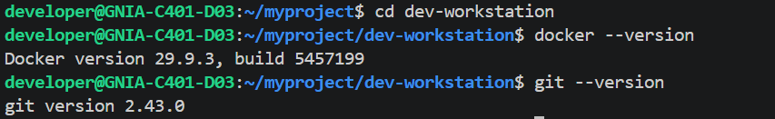

> 서울캠퍼스 sudo 제약 환경에서는 OrbStack을 쓰지만, 본 실습 PC는 Windows + WSL2 환경이라 Docker Desktop을 사용했습니다. Docker Desktop 실행 시 Docker 엔진이 함께 구동되며 WSL 터미널에서 `docker` 명령을 동일하게 사용합니다.

---

## 3) 수행 항목 체크리스트

- [x] Docker 설치/점검 (`docker --version`, `docker info`)
- [x] 기본 운영 명령 (`images` / `ps` / `logs` / `stats`)
- [x] `hello-world` 실행
- [x] Dockerfile 기반 커스텀 이미지 빌드/실행
- [x] 포트 매핑 접속 성공 (2회, 포트 2개)
- [x] 바인드 마운트 변경 반영 확인
- [x] Docker 볼륨 영속성 확인 (컨테이너 삭제 전/후)
- [x] Git 사용자/기본 브랜치 설정 + `git config --list`
- [x] GitHub 저장소 연동 및 push
- [ ] 터미널 기본 조작 및 폴더 구성 로그 정리  ⬜ 남은 작업
- [ ] 파일/디렉토리 권한 변경 실습 (변경 전/후 비교)  ⬜ 남은 작업

---

## 4) 터미널 조작 로그  ⬜ (남은 작업)

> 아래 명령을 실행하고 **입력 + 출력**을 남기세요.

```bash
pwd
mkdir -p ~/codyssey/practice && cd ~/codyssey/practice
ls -la
touch sample.txt
cp sample.txt sample_copy.txt
mv sample_copy.txt renamed.txt
rm renamed.txt
echo "hello codyssey" > sample.txt
cat sample.txt
```
```text
# 출력 ↓
<!-- 붙여넣기 -->
```

---

## 5) 권한(Permission) 실습  ⬜ (남은 작업)

```bash
touch perm_file.txt
mkdir perm_dir
ls -l perm_file.txt ; ls -ld perm_dir      # 변경 전
chmod 644 perm_file.txt
chmod 755 perm_dir
ls -l perm_file.txt ; ls -ld perm_dir      # 변경 후
```

| 대상 | 변경 후 | 의미 |
|------|---------|------|
| `perm_file.txt` | `-rw-r--r--` (644) | 소유자 읽기/쓰기, 그 외 읽기 |
| `perm_dir` | `drwxr-xr-x` (755) | 소유자 전체, 그 외 읽기/실행 |

```text
# 출력 ↓ (변경 전/후 ls 결과)
<!-- 붙여넣기 -->
```

---

## 6) Docker 설치 및 기본 점검

```bash
docker --version
docker info
```

**Client / 플러그인**
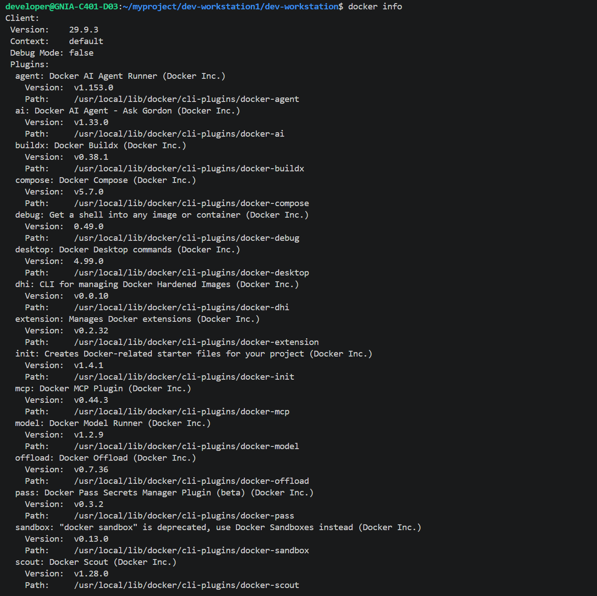

**Server (엔진 동작 확인)** — `Server Version: 29.9.3`, `Storage Driver: overlay2`, `Cgroup Version: 2`, `OSType: linux`
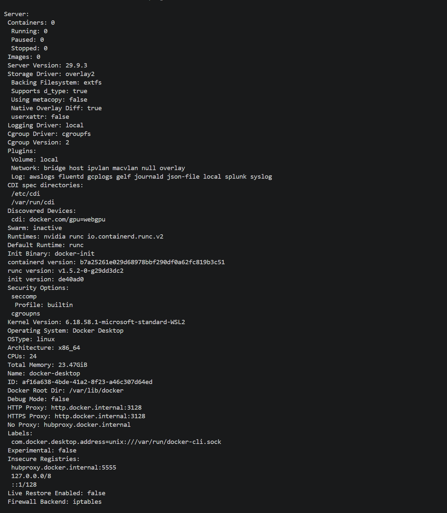

---

## 7) Docker 기본 운영 명령

```bash
docker logs <컨테이너명>
docker stats --no-stream
```

**로그 (nginx 기동 + 접속 기록)**
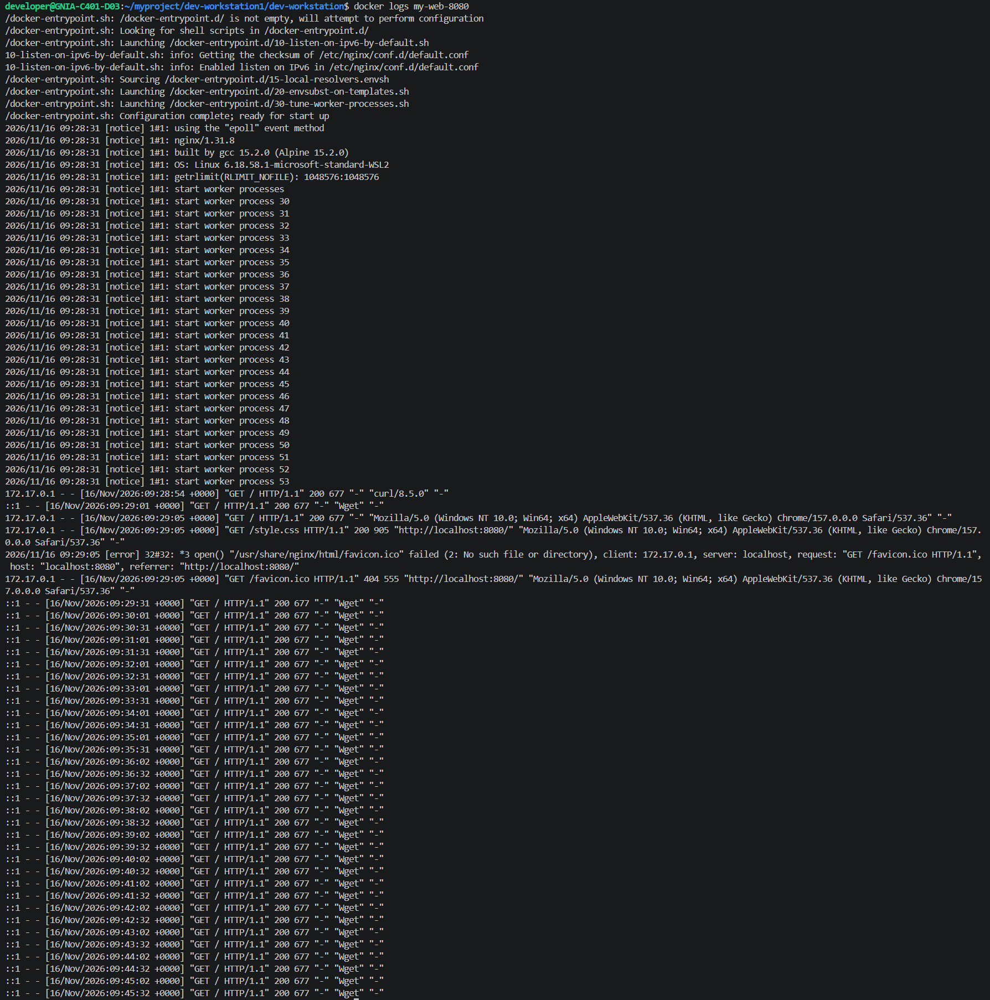

**리소스 사용량**
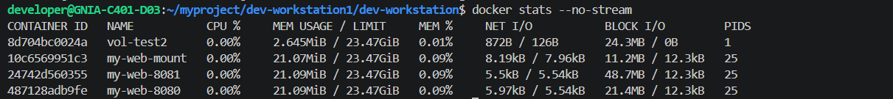

> `docker images` / `docker ps` 증거는 9번·10번 섹션의 스크린샷에 함께 포함되어 있습니다.

---

## 8) 컨테이너 실행 실습

### 8-1. hello-world
```bash
docker run hello-world
```
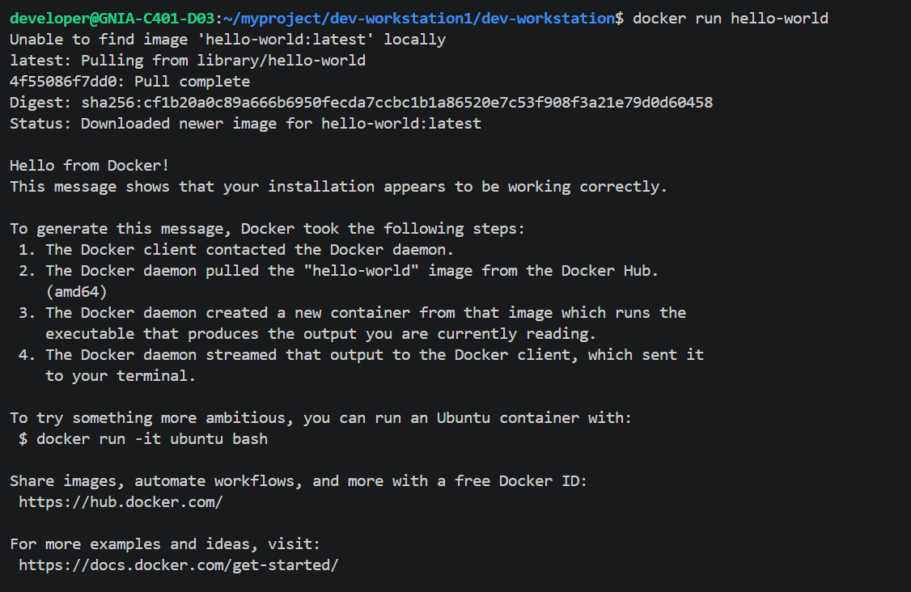

### 8-2. ubuntu 진입 후 명령  ⬜ (남은 작업)
```bash
docker run -it ubuntu bash
#  내부에서:  ls / ; echo "inside container" ; exit
```
```text
# 출력 ↓
<!-- 붙여넣기 -->
```
> 참고: 11-2) 볼륨 실습에서 ubuntu 컨테이너를 `docker exec`로 다뤘습니다.

### 8-3. attach vs exec / 종료·유지 차이  ⬜ (남은 작업)
- `docker run -it ... bash` 에서 `exit` → ⬜
- `docker run -d ...` 후 `docker exec -it ... bash` 에서 `exit` → ⬜
- 관찰 요약: ⬜

---

## 9) 커스텀 이미지 제작 (Dockerfile)

**선택한 베이스**: `nginx:alpine` (옵션 A — 웹 서버 베이스 + 정적 콘텐츠 교체)

| 커스텀 포인트 | 목적 |
|--------|------|
| `LABEL` 메타데이터 | 이미지 식별/문서화 |
| `ENV APP_ENV=dev` | 환경 변수로 실행 모드 분리 |
| `COPY site/ ...` | 내가 만든 정적 콘텐츠로 기본 페이지 교체 |
| `HEALTHCHECK` | 컨테이너 상태 점검 자동화 |

```bash
docker build -t my-web:1.0 .
docker images | grep my-web
```

**빌드 성공**
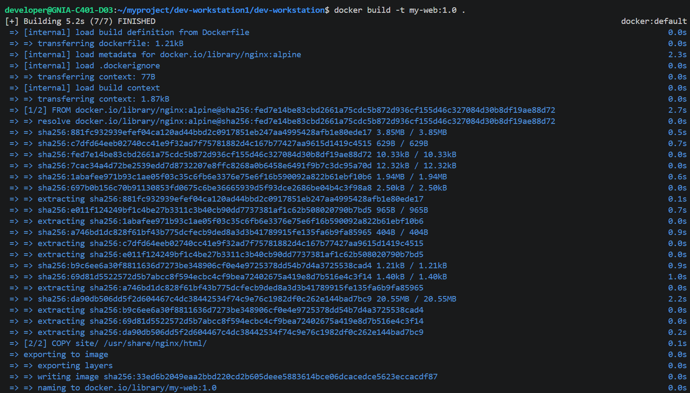

**이미지 생성 확인** (`my-web  1.0  63MB`)
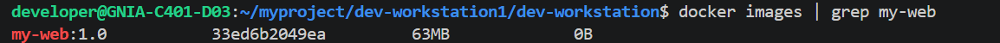

---

## 10) 포트 매핑 및 접속 증거 (2회)

같은 이미지를 호스트 포트만 바꿔 2개 실행 → 격리된 컨테이너 + 포트 매핑 확인.

### 8080 포트
```bash
docker run -d -p 8080:80 --name my-web-8080 my-web:1.0
docker ps
curl http://localhost:8080
```
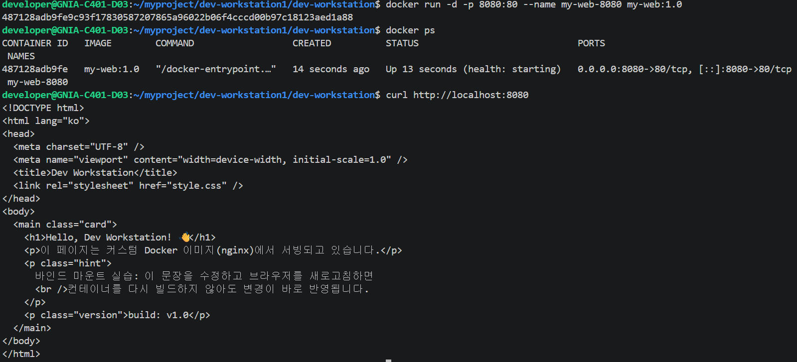

**브라우저 접속 (주소창 `localhost:8080` 포함)**
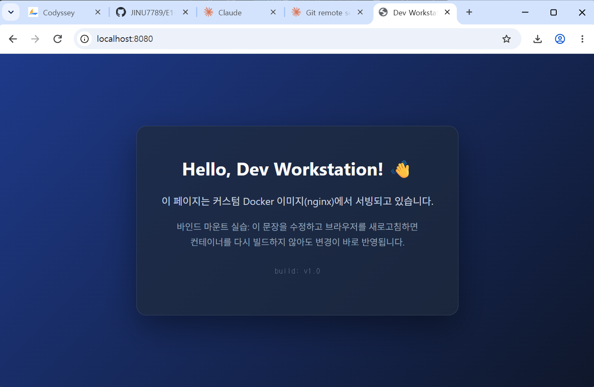

### 8081 포트
```bash
docker run -d -p 8081:80 --name my-web-8081 my-web:1.0
docker ps
curl http://localhost:8081
```
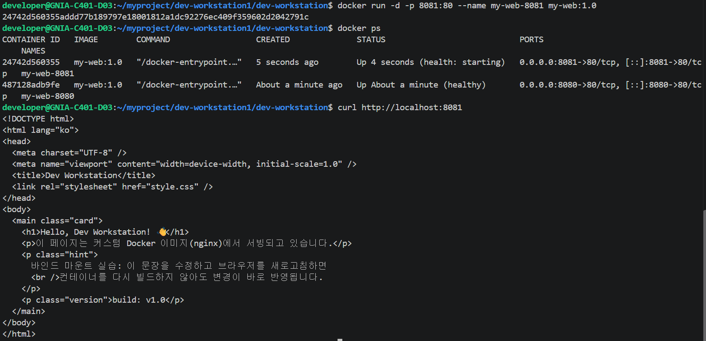

**브라우저 접속 (주소창 `localhost:8081` 포함)**
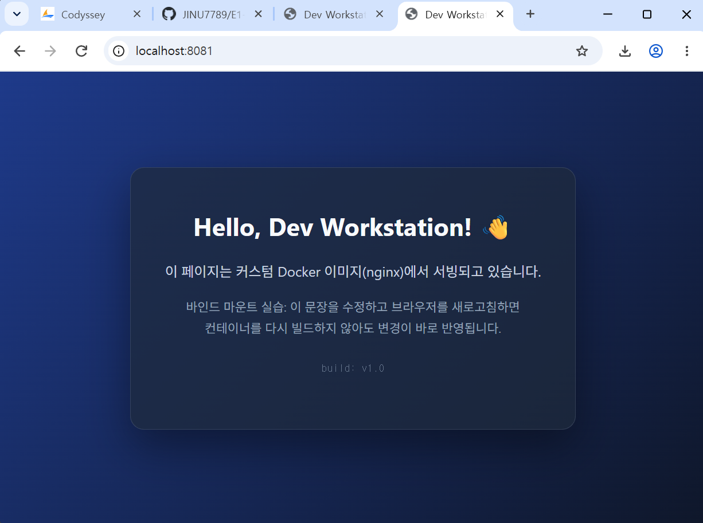

---

## 11) 바인드 마운트 반영 + 볼륨 영속성

### 11-1. 바인드 마운트 (변경 즉시 반영)
```bash
docker run -d -p 8082:80 -v "$(pwd)/site:/usr/share/nginx/html:ro" --name my-web-mount my-web:1.0
```
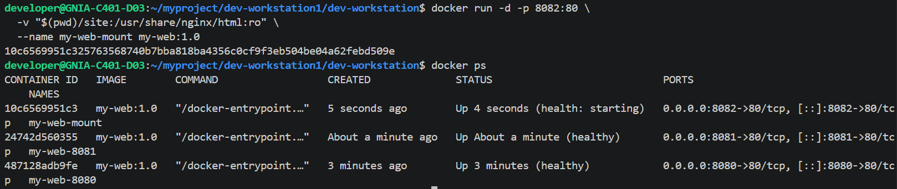

**변경 전** — `localhost:8082`
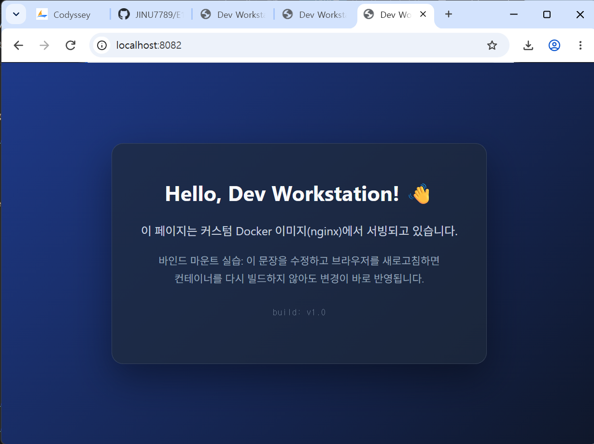

**파일 수정** — `site/index.html`의 `<h1>` 문구 교체 (재빌드 없음)
```bash
sed -i 's|<h1>.*</h1>|<h1>바인드 마운트 반영 성공! 🎉</h1>|' site/index.html
curl http://localhost:8082 | grep h1
```
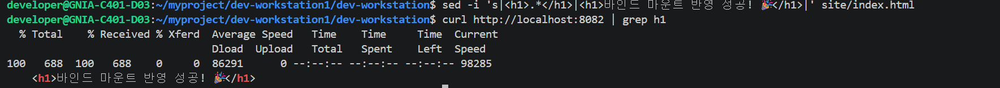

**변경 후** — 새로고침만으로 반영됨
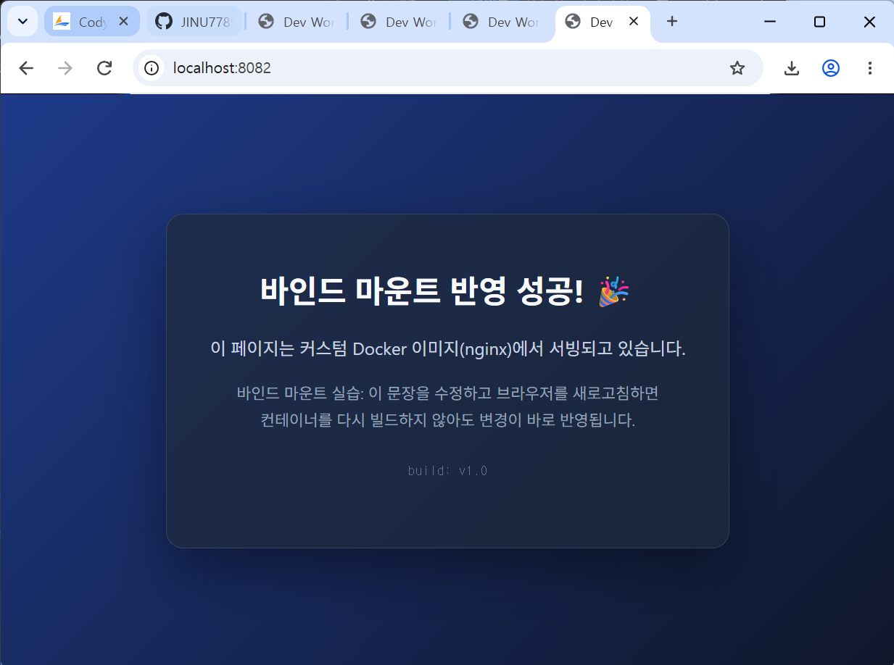

> 이미지는 그대로인데 호스트 파일만 고쳐도 실행 중 컨테이너에 즉시 반영 → "코드 수정 → 즉시 확인" 개발 흐름의 기반.

### 11-2. Docker 볼륨 (영속성)
```bash
docker volume create mydata
docker run -d --name vol-test -v mydata:/data ubuntu sleep infinity
docker exec vol-test bash -lc "echo hi > /data/hello.txt && cat /data/hello.txt"   # hi
docker rm -f vol-test                                                              # 컨테이너 삭제
docker run -d --name vol-test2 -v mydata:/data ubuntu sleep infinity
docker exec vol-test2 bash -lc "cat /data/hello.txt"                               # hi (유지됨!)
```
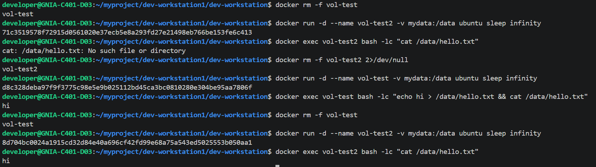

> ✅ 컨테이너를 삭제해도 볼륨 데이터가 유지됨을 확인 (이미지/컨테이너와 데이터의 분리).

---

## 12) Git 설정 및 GitHub 연동

```bash
git config --global user.name "..."
git config --global user.email "..."
git config --global init.defaultBranch main
git config --list
```
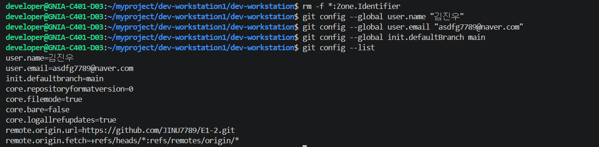

```bash
git init
git add .
git commit -m "feat: dev-workstation 개발 워크스테이션 구축 산출물"
git remote add origin https://github.com/JINU7789/E1-1.git
git branch -M main
git push -u origin main
```
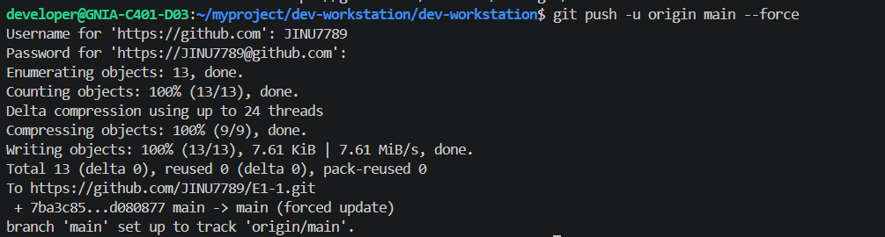

> 보안: 토큰/비밀번호 등 민감정보는 로그·스크린샷에 포함하지 않았습니다.

### VSCode ↔ GitHub 연동  ⬜ (남은 작업)

> ⬜ VSCode에서 GitHub 로그인 + 저장소 연동 화면을 캡처해 `docs/images/12-github-vscode.png`로 저장하세요.

---

## 13) 트러블슈팅

### 트러블슈팅 1 — Docker 데몬 연결 실패
- **문제**: `docker run hello-world` 실행 시 `failed to connect to the docker API ... dockerDesktopLinuxEngine` 오류
- **원인 가설**: Docker CLI는 있으나 엔진(데몬)이 실행되지 않음
- **확인**: 에러 메시지의 `dockerDesktopLinuxEngine` 경로 / `docker info` 의 Server 미응답
- **해결**: Docker Desktop을 실행해 엔진 기동 → `docker info` Server 정상 → hello-world 성공

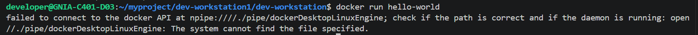

### 트러블슈팅 2 — 볼륨에 데이터가 없다고 나옴
- **문제**: 볼륨 영속성 테스트 마지막에 `cat: /data/hello.txt: No such file or directory`
- **원인 가설**: 데이터를 **기록하는 명령(`echo hi > ...`)을 건너뛰고** 컨테이너를 삭제함 (볼륨엔 쓴 적 없음)
- **확인**: 실행 순서를 되짚어 쓰기 단계 누락 발견
- **해결**: 쓰기 → 삭제 → 재연결 순서를 지켜 재실행하니 `hi` 유지 확인 (11-2 스크린샷)

---

## 14) 학습 목표 자가 점검  ⬜ (본인 말로 채우기)

1. **절대 경로 vs 상대 경로** — ⬜
2. **파일 권한 r/w/x 와 755·644 해석** — ⬜
3. **기존 Dockerfile 기반 커스텀 이미지 만들기** — ⬜
4. **포트 매핑이 필요한 이유** — ⬜
5. **Docker 볼륨(영속 데이터)** — ⬜
6. **Git vs GitHub (로컬 버전관리 vs 원격 협업)** — ⬜

---

## 🎁 보너스 (선택)
- [ ] Docker Compose 단일 서비스 (`docker compose up -d --build` → `ps/logs/down`)
- [ ] 환경 변수로 설정 분리 (`APP_ENV`)
- [ ] GitHub SSH 키 등록 및 push

```bash
docker compose up -d --build
docker compose ps
docker compose logs -f
docker compose down
```

---

## 🔒 보안 체크
- [x] 로그/스크린샷에 토큰·비밀번호·개인키·인증코드 없음
- [x] `.env`, `*.key`, `*token*`, `*:Zone.Identifier` 은 `.gitignore` 로 커밋 제외
